# Offline AI

**Download a model once, then use it offline forever.**

Offline AI is an on-device AI app for your phone: chat, study, and work with AI models that run entirely on the device — no internet needed once the model is downloaded, no account, no subscription, and nothing you type ever leaves your phone.

> **Status:** In development. This repository is a showcase only — README and screenshots.
> The Offline AI source code is not shared here.

## What it does

- **Fully offline chat** — Ask anything, summarise text, write letters, translate, explain simply, or get study help, with the model running on your phone.
- **Downloadable models** — Pick a model once and keep it. Bigger models are smarter but need more RAM; tiny models fit almost any phone. Text models, vision models, coding models, and reasoning models are all listed in the app.
- **Docs Q&A** — Add PDFs or text files, then ask questions about them in Chat — fully offline.
- **Notebook** — Jot ideas and notes, searchable from the app.
- **Cameroon exam past papers** — Real Cameroon exam papers from official/free sources, to download and study with the AI in Docs.
- **Cameroon languages phrasebook** — Add a phrase and its translation, and help build an offline AI for Cameroonian languages. Entries are saved on your phone and can be exported.
- **AI Tips** — Guidance on why offline AI matters and how to write a good prompt.

## Privacy, by design

- 100% private — nothing you type ever leaves your phone.
- Works with no internet, anywhere, anytime.
- No account, no subscription, no data collection.
- Perfect for travel, weak networks, or sensitive topics.

## Models shown in the screenshots

Models are listed with size, quantisation, download size, and RAM needed, so you can pick what your phone can actually run — from ultra-tiny models like Qwen 3 0.6B (461 MB, 1 GB+ RAM) and Qwen 2.5 0.5B (398 MB), through the smallest vision model SmolVLM (870 MB), up to 32B desktop/workstation models (18+ GB). Vision models include Gemma 3 4B, Qwen 2.5 VL 7B, and Gemma 3 12B. The screenshots show DeepSeek R1 Distill 8B downloaded and loaded as the active model, and DeepSeek R1 Distill 7B downloaded.

## Settings

- Use GPU (Vulkan) if available, for faster answers on supported phones.
- Speak replies aloud, using on-device text-to-speech.
- Smart tools: answer maths and date/time questions instantly and exactly, without the model.
- Auto-load last model when the app opens.
- Agent mode: let the AI use tools — calculator, date/time, unit conversion, device info, and search your documents.

## Screenshots

### Chat

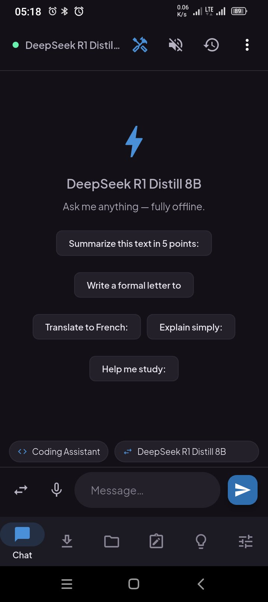
*Offline chat — DeepSeek R1 Distill 8B, fully offline.*

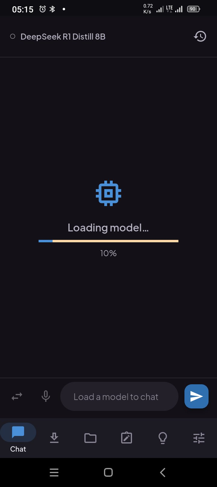
*Loading a model — DeepSeek R1 Distill 8B at 10%.*

### Models

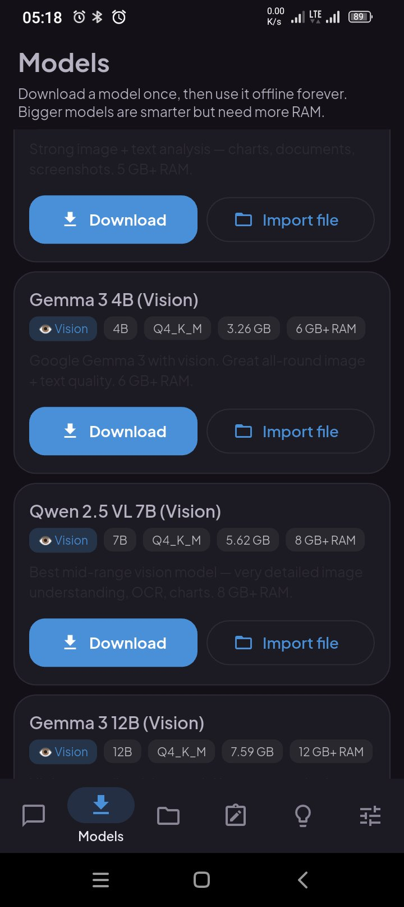
*Vision models — Gemma 3 4B, Qwen 2.5 VL 7B, Gemma 3 12B.*

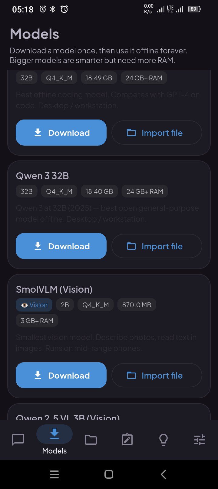
*Large models — 32B models and SmolVLM, the smallest vision model.*

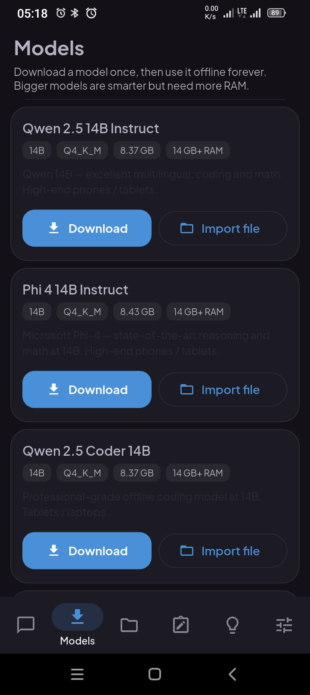
*14B models — Qwen 2.5 14B, Phi 4, Qwen 2.5 Coder.*

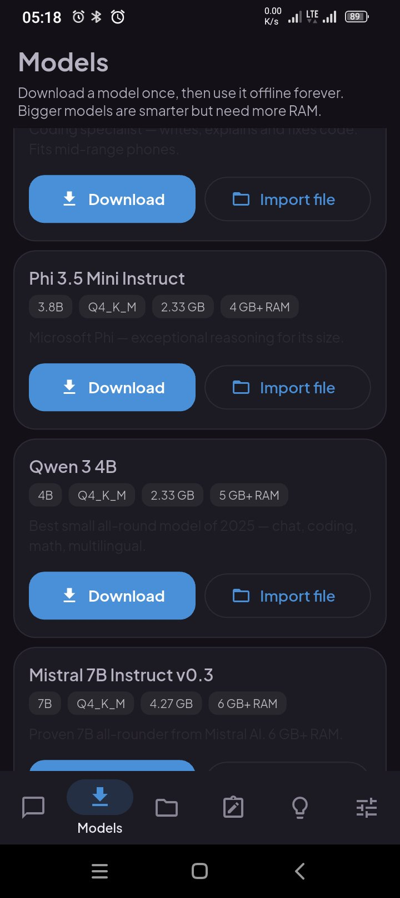
*Small models — Phi 3.5 Mini, Qwen 3 4B, Mistral 7B.*

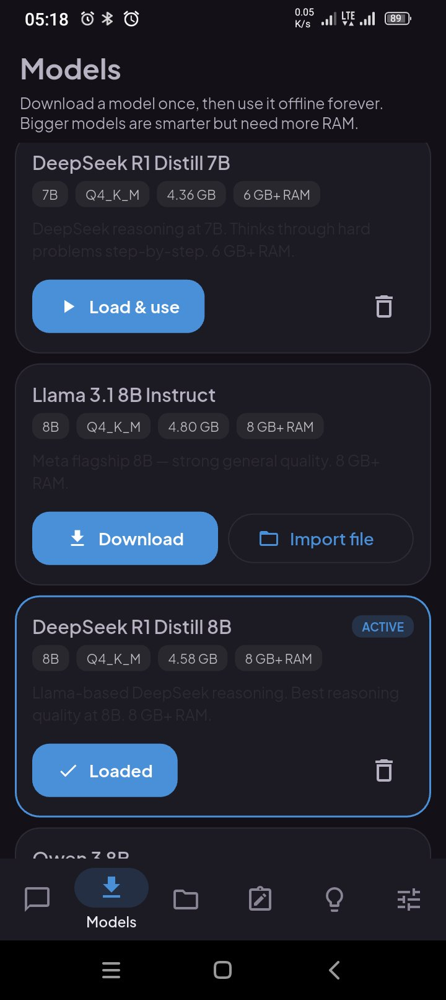
*Downloaded models — DeepSeek R1 Distill 8B loaded and active.*

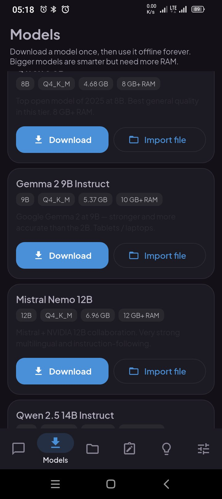
*Gemma 2 9B and Mistral Nemo 12B.*

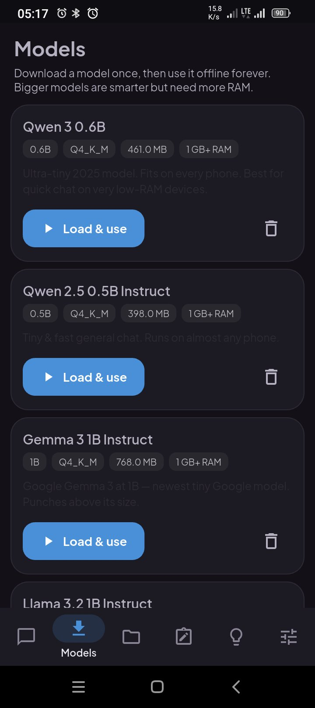
*Tiny models — Qwen 3 0.6B, Qwen 2.5 0.5B, Gemma 3 1B, Llama 3.2 1B.*

### Tips, languages, and settings

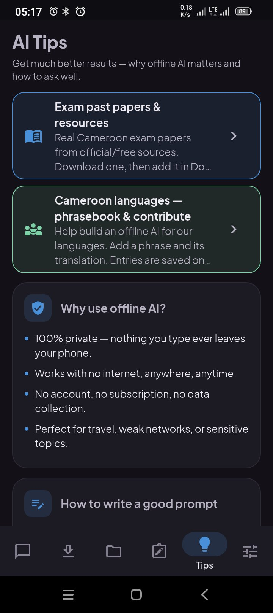
*AI Tips — exam past papers, Cameroon languages, and how to write a good prompt.*

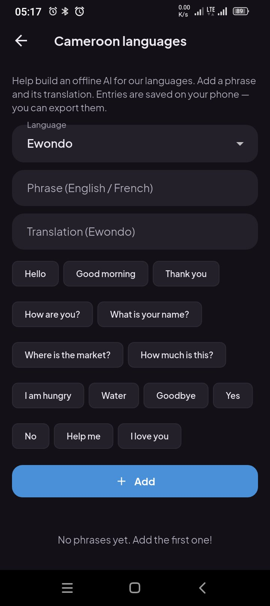
*Cameroon languages phrasebook — Ewondo, with phrases to add and translate.*

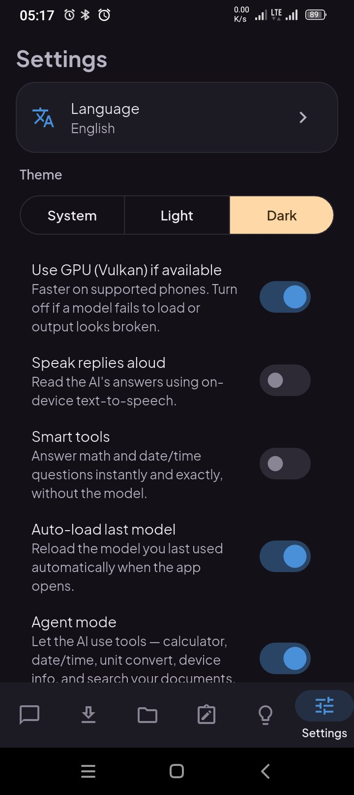
*Settings — GPU, speech, smart tools, auto-load, and agent mode.*

### Notebook, Docs, and the app icon

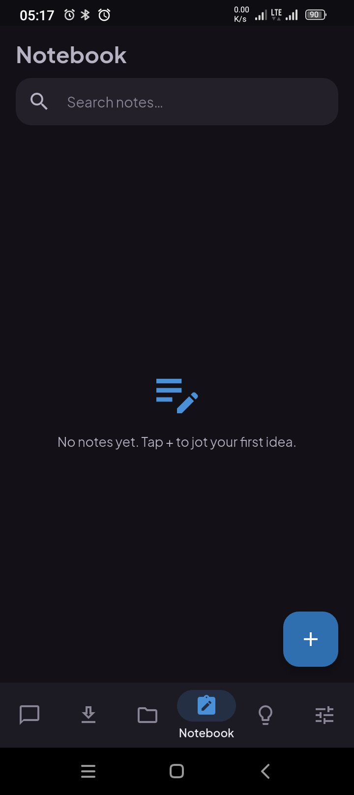
*Notebook — search notes, tap + to jot your first idea.*

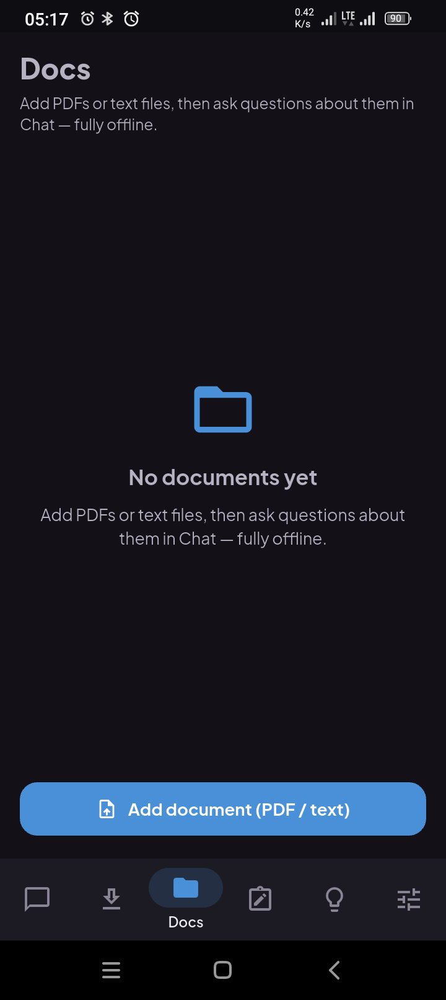
*Docs — add PDFs or text files, then ask questions about them offline.*

*The Offline AI app icon, cropped from the phone home screen.*

## Showcase only — no source code

This repository contains no application source code, no API keys, and no credentials. Please do not open issues asking for the source code.

## About the builder

Built by **Yemeli Juiazong Abel Cedrique** — Web & Mobile Developer, Yaoundé, Cameroon.

- LinkedIn: https://www.linkedin.com/in/yemeli-abel-256065171
- Other public work: https://github.com/Yemeli/tchop
- SocialHub showcase: https://github.com/Yemeli/socialhub
